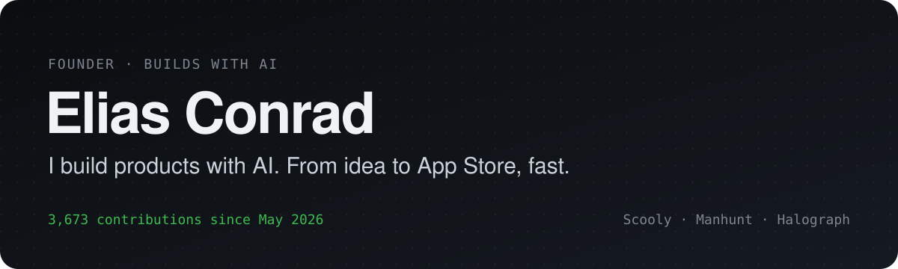
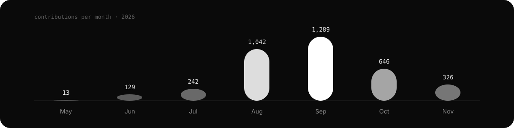

I build agentic infrastructure and the products on top of it: AI agents, the memory and tools they need to be useful, and the apps people actually use. I run open-weight models in production, I build with several agents at once, and honestly, I think this whole AI game is the most exciting thing happening right now. I decide what gets built, the agents help me build it fast, and I own the result: design, security, data, launch.

[**Website**](https://eliasconrad.eu) · [Instagram](https://instagram.com/eliascnrd) · [Scooly](https://scooly.dev) · [Manhunt](https://manhunt-app.com)

```text
⠀⠀⠀⠀⠀⠀⠀⠀⠀⠀⠀⠀⠀⠀⠀⠀⠀⠀⠀⠀⠀⠀⠀⠀⠀⠀⠀⠀⠀⠀⠀⠀⠀⠀⠀⠀⠆⠂
⠀⠀⠀⠀⠀⠀⠀⠀⠀⠀⠀⠀⠀⠀⠀⠀⠀⠀⠀⠀⠂⠀⠐⠊⠢⠠⢆⠀⠀⡀⡀⢀⠀⠀⠀⠁⠀⡁⡑⡀
⠀⠀⠀⠀⠀⠀⠀⠀⠀⠀⠀⠀⠀⠀⠀⠀⠀⠀⠀⠀⠀⠀⠀⠄⠁⠁⠀⠂⠃⢊⠔⠐⠀⠀⠀⠀⠀⠀⠂⠊⠨⢐⠀⠀⠀⠐
⠀⠀⠀⠀⠀⠀⠀⠀⠀⠀⠀⠀⠀⠀⠂⠀⠀⠀⠀⠀⠀⢀⢤⣀⡀⡀⠀⠀⠀⠀⠀⠀⢀⢰⡐⠅⠅⢀⠀⠀⠀⠀⠈⠀⠀⠀⠀⠀⠑
⠀⠀⠀⠀⠀⠀⠀⠀⠀⠀⠀⠠⠀⠀⠀⠂⠀⡀⠀⢠⢨⠊⠀⠀⠈⠑⢆⠀⠀⠀⠀⠠⠊⠀⠀⠀⡀⢄⢕⠄⠄⠠⠀⠀⢀⠀⠀⠀⠀⠀⠀⠠
⠀⠀⠀⠀⠀⠀⠀⠀⠀⠀⠐⠈⠀⢀⠂⠄⠂⢐⢀⡓⠁⠀⠠⠀⠀⠀⠄⠡⠀⠐⠀⠀⠀⠀⠀⠈⠀⠀⠃⡁⠀⠁⠂⠀⠀⢰⠀⠀⠐
⠀⠀⠀⠀⠀⠀⠀⠀⠀⠀⡀⠀⢠⠑⠀⡐⠀⢢⠢⠀⠀⠀⠀⠀⢀⢂⠢⡐⡌⡢⡢⣑⢔⡤⡄⡄⣀⢀⠐⠘⡠⡠⠀⠀⠀⢒⠀⠀⠀⠁
⠀⠀⠀⠀⠀⠀⠀⠀⠀⢀⠀⡐⠅⠀⠀⠅⠀⠨⠯⠀⡀⡠⣰⡸⣦⣷⣻⡽⣺⣾⣝⣯⣟⣮⡻⣞⣯⢿⢝⡮⡆⡊⠌⠌⠂⠅⠁⠀⠀⢄⠂
⠀⠀⠀⠀⠀⠀⠀⠀⠀⡀⠑⢌⠄⠄⠀⠱⡠⢀⢅⠣⡃⡇⣗⣯⣟⣞⡮⣞⣟⣞⣗⣗⣗⣗⡯⣗⣯⣫⢗⣇⠅⡃⠐⠀⡑⡐⢀⠀⠀⢐⠀⠀⠀⠀⠆
⠀⠀⠀⠀⠀⠀⠀⠀⠀⠀⠈⠰⡑⠄⠠⡂⡕⡤⣕⢕⣔⣕⣬⣪⢮⣾⣽⢷⣻⢿⣞⣗⣟⣞⣞⡽⡾⡽⡯⡾⣻⢴⠀⠂⢐⢌⢢⢰⠁⠀⠀⠀⠄⠂
⠀⠀⠀⠀⠀⠀⠀⠀⠀⠀⠠⠁⠠⠨⢂⠢⡹⡌⡞⣜⡾⡾⣞⣯⡿⣗⣿⢽⣯⢿⣞⣷⡻⣺⡪⡾⣝⢽⡺⡝⡮⡳⣕⢢⢱⢐⡱⣃⠀⢠⠂⠁⠅⠁⠀⡁
⠀⠀⠀⠀⠀⠀⠀⠀⠈⠐⠠⠑⡈⠄⠄⢀⠧⡃⣕⣗⢯⣻⣝⣗⣟⣯⡯⣿⢞⣿⣽⢾⣽⣺⣺⣽⢞⣗⣵⣝⡮⡯⡮⡳⡱⡱⡨⢢⡣⡥⢁
⠀⠀⠀⠀⠀⠀⠀⠀⠀⠈⠌⡂⠀⡕⡂⢡⣿⣺⣳⣽⣯⣷⣿⣾⣿⣳⣿⣿⣽⣽⣯⣿⢷⣿⣾⣟⣿⣽⡾⡷⡿⠝⠎⠟⢼⢘⡘⡆⡝⡌⡂⡐⠀⠢⠀⠀⠠
⠀⠀⠀⠀⠀⠀⠀⠀⡀⡀⠀⠀⠀⡂⢐⠱⣽⣷⢟⠏⠝⠙⠕⠛⠞⠋⠻⢺⣫⣿⡯⣿⣻⡿⡱⠙⠈⠀⠀⠀⠀⠀⢂⠠⡀⡁⠑⡜⣌⠇⠄⠀⡊⠘⠌⠂⡈
⠀⠀⠀⠀⠀⠀⠀⠀⠈⠈⠀⠀⡀⠀⠀⡸⣟⡇⡁⡀⡀⡀⡀⠀⠀⣀⣢⢰⢼⣷⣿⣟⣯⣷⢕⣴⣲⣤⣤⣴⢶⣷⣷⡯⡮⣢⢕⠸⡸⡨⠀⠀⠀⠐⠐⣨
⠀⠀⠀⠀⠀⠀⠀⠀⠀⠀⠈⠀⠀⠀⠀⡺⣻⣖⣮⣾⢿⡿⣿⣿⡿⠟⠾⡳⣝⡾⡻⣺⠸⠨⡳⣽⠻⣙⠚⠛⠛⠻⠺⠿⣝⢗⡧⡣⡣⡹⡀⠀⠀⠀⠀⠐⠡
⠀⠀⠀⠀⠀⠀⠀⠀⠀⠀⠠⠀⠀⠀⠀⢪⣿⣯⣷⣻⠟⠋⢉⠀⠀⠀⢶⣨⣳⢣⣫⢮⡪⡊⠌⡪⣦⢯⣆⣤⣠⣰⣄⡤⡱⡹⣺⡱⡱⠪⡀⢀⢰⡐⠄⠀⠸
⠀⠀⠀⠀⠀⠀⠀⠀⠀⠀⠀⠀⢀⡀⠀⢘⢾⣷⣳⢵⢴⣶⣳⣖⣷⣫⢗⡵⡣⣣⡷⣫⢎⠆⡊⠌⡬⡫⡿⣽⡿⣽⣳⡻⡮⡳⡱⡕⡕⡕⡂⡪⡲⠙⠌⠠⠁
⠀⠀⠀⠀⠀⠀⠀⠀⠀⠀⠀⠐⡍⡖⡆⡈⣯⣷⢯⢯⢟⡽⡯⣟⣾⣳⡟⡮⡺⣕⣿⣳⡳⡡⢑⢕⢌⢯⣺⢕⣟⢺⡪⣗⡽⣹⡱⣱⢱⢱⠠⠑⣽⡌⢨⠇
⠀⠀⠀⠀⠀⠀⠀⠀⠀⠀⠀⠀⢣⢪⢿⣆⢺⡾⡽⣝⡽⡽⣽⢽⣞⣯⢾⡝⣝⢼⣺⣗⣯⣒⠄⠑⢱⣪⢾⢝⡼⣱⣝⢮⡺⣕⢝⢆⢇⢧⢣⠣⠣⡣⡙
⠀⠀⠀⠀⠀⠀⠀⠀⠀⠀⠀⠀⠸⡨⣻⣕⡼⣗⣟⣗⣯⢿⢽⢯⣾⣺⣯⡧⣗⣿⡿⣿⡷⡗⡯⣪⡢⠚⡿⣿⣝⡵⣳⢽⢕⢷⣹⢱⢱⠱⡍⣀⡄⢆⡇
⠀⠀⠀⠀⠀⠀⠀⠀⠀⠀⠀⠀⠀⠘⣞⡕⢿⣻⣺⣺⢵⣟⣿⣻⢾⣽⣷⡯⣃⡁⣏⢏⠫⡠⣀⡬⡏⡢⣹⣿⢾⡯⣗⣯⢯⢗⡇⡇⡇⢇⡫⡳⢕⠱
⠀⠀⠀⠀⠀⠀⠀⠀⠀⠀⠀⠀⠀⠀⠐⢙⡾⣾⣪⢾⢽⣞⣮⡿⣿⣻⣽⡾⡶⣝⣿⢿⣽⣿⡳⣕⢮⢺⣝⢞⡿⣟⣯⡾⣝⢵⡹⡸⡸⡱⠱⠳⢑⡅
⠀⠀⠀⠀⠀⠀⠀⠀⠀⠀⠀⠀⠀⠀⠀⠀⡯⣻⣞⡽⡽⣞⣷⣿⢿⡯⡷⣫⡫⡫⣫⣛⢝⣗⣍⢲⢱⢳⢸⢕⡭⡫⣗⢯⢳⢱⢱⢹⡪⡇⠀⠀⠒⡼⡀
⠀⠀⠀⠀⠀⠀⠀⠀⠀⠀⠀⠀⠀⠀⠀⠀⠈⠀⢸⣽⢽⣳⣻⣺⢯⣯⣿⢼⢺⢝⢍⢺⢫⢃⠧⡹⡜⢞⠝⢷⢷⣧⡳⣕⢝⢜⡕⣗⣽⠀⠀⠀⠀⠮⠢⡀
⠀⠀⠀⠀⠀⠀⠀⠀⠀⠀⠀⠀⠀⠀⠀⠀⠀⢀⠀⢿⣽⢷⣻⣞⡿⡯⡣⡡⡡⡌⡬⡨⡈⣔⡌⡆⡎⢄⢔⣜⢕⣷⢿⣕⢧⢣⣫⢺⡊⠀⠀⠀⢰⡢⠫
⠀⠀⠀⠀⠀⠀⠀⠀⠀⠀⠀⠀⠀⠀⠀⠀⠀⠰⡠⠘⣽⣿⣽⣾⣿⢯⣳⣕⢕⢕⢝⢵⢳⢫⢫⢊⢆⢇⡗⡵⡫⣾⣻⢜⣎⢮⢪⡳⡁⠀⠀⢀⠶⠒⠁
⠀⠀⠀⠀⠀⠀⠀⠀⠀⠀⠀⠀⠀⠀⠀⠀⠀⠀⠐⠀⠘⣾⢷⣳⢽⣻⣵⡳⡯⣗⡧⡦⣕⣴⣢⢧⣗⣟⡮⣳⣫⣗⣗⢽⢸⡸⢵⡹⡀⠀⠀⣨⠃
⠀⠀⠀⠀⠀⠀⠀⠀⠀⠀⠀⠀⠀⠀⠀⠀⠀⠀⢁⠀⠀⣻⣟⡽⡽⡽⣮⢯⡿⣽⣯⣿⣯⣿⢾⣻⢽⣺⢽⢵⡳⣳⢱⢕⢕⢝⢼⢸⠂⠀⠰
⠀⠀⠀⠀⠀⠀⠀⠀⠀⠀⠀⠀⠀⠀⠀⠀⠀⠀⠀⠀⠀⡽⡾⣧⡫⢯⢿⢽⣯⡿⣾⢷⡿⣞⣿⢽⣽⣺⣝⣵⡫⡞⠕⢅⢇⢇⢧⢣⢡⠔
⠀⠀⠀⠀⠀⠀⠀⠀⠀⠀⠀⠀⠀⠀⠀⠀⠀⠀⠀⠀⠀⡕⣟⣟⣾⣕⠭⡻⣵⢿⣻⢯⡿⣻⢾⢿⡵⣷⡻⡞⢍⠪⡱⡱⢝⢎⠎⡆⢕⡀
⠀⠀⠀⠀⠀⠀⠀⠀⠀⠀⠀⠀⠀⠀⠀⠀⠀⠀⠀⢀⠴⡱⣕⣟⣾⣽⡽⣪⢪⣹⡘⡝⡊⠏⡋⠫⡚⡌⡪⡰⡡⡱⡱⡹⡸⡪⡺⡘⢄⠑⠄⡀
⠀⠀⠀⠀⠀⠀⠀⠀⠀⠀⠀⠀⠀⠀⠀⠀⠀⢀⢄⢦⢑⢕⡵⣳⣫⣷⣟⡵⡫⣞⢿⢿⣻⣷⣽⣵⢇⡯⣺⢸⢰⢱⡹⡸⡱⡕⡯⡱⠡⢂⠂⢅⢁⠀⠀⢀
⠀⠀⠀⠀⠀⠀⠀⠀⠀⠀⠀⠀⠀⠀⠀⠀⠠⣷⡯⣣⢇⢗⣝⢗⣟⡾⣯⣷⢏⡮⡯⣏⡯⡷⡿⡹⣕⡯⡮⡣⡣⣳⢕⣏⢗⣕⠵⡑⡕⠠⡑⡕⡼⣰⡀⠀⠀⠈
⠀⠀⠀⠀⠀⠀⠀⠀⠀⠀⠀⠀⠀⠀⠀⠀⠈⣿⣯⡗⡕⣕⢵⡫⡾⣽⣻⡾⣟⡮⣯⣺⢽⣪⢞⣝⣮⣞⢵⢱⣹⣺⡽⣪⢳⡸⢜⡪⡂⡱⡐⡕⣝⣿⠂⠀⠀⠀⠀⠀⠀⠁
⠀⠀⠀⠀⠀⠀⠀⠀⠀⠀⠀⠀⠀⠀⠀⠀⠀⠹⣷⣟⢵⢕⡷⣹⢝⡾⣵⣻⣻⣺⢵⡻⣿⣻⢯⡿⣞⢮⡳⣝⢾⢵⡫⡞⡕⣕⢇⢇⢇⢪⣪⢮⡯⡏
```

**About** · Founder, based in Germany. Before May 2026 I designed websites for businesses. Now I build agentic infrastructure, iOS apps, web apps and the servers behind them, with several AI agents running in parallel and me reviewing everything they ship. I care about the details people feel: speed, motion, copy. Privacy and security are part of the product, not an afterthought.

**Right now** · Getting **Scooly** ready for the App Store, building rounds and the social feed for **Manhunt**, and teaching AI agents to remember with **Halograph**.

**Ask me about** · Agentic infrastructure · Open-weight models in production · MCP · Shipping with AI agents · SwiftUI · Cloudflare Workers

## By the numbers

| 3,673 | 141 | 169 | 6 months |
| :---: | :---: | :---: | :---: |
| contributions | days with commits | commits on the busiest day | since the first commit |

## Now shipping

| | What it is | Where it stands |
| --- | --- | --- |
| **[Scooly](https://scooly.dev)** | AI study app that gets students through their next exam: exam prep, practice and an AI tutor. | iOS app in TestFlight since August 2026, waitlist open |
| **[Manhunt](https://manhunt-app.com)** | Real-life chase game for friends: hunters against runners, a shrinking zone, and every round lands in the feed. | Prototype on iOS, server live |
| **[Halograph](https://github.com/eliasconrad/halograph-skills)** | A memory for AI agents. Mails, messages, meetings and notes in one place, so Claude, Cursor and Grok know the context without being told. | Running daily, [open skill](https://github.com/eliasconrad/halograph-skills) for any MCP client |

## Also built

- **[Facet](https://eliasconrad.github.io/facet/)** · a focus blocker for the Mac
- **[Scooly Status](https://status.scooly.dev/)** · public status page for Scooly's services
- **Cue** · a desktop app to plan, script and publish social media content for a brand
- **Client websites** · rebuilt business websites from WordPress to fast static sites, with SEO and privacy built in

## The story so far

Before 2026 I designed websites: layouts, brands, copy, the whole look and feel for businesses. In **May 2026** I started building software myself and opened this GitHub account on May 10. Everything here happened since then.

Three months later the first Scooly build was on TestFlight. By September it had its own backend, payments through the App Store, a website and a waitlist, and I moved the whole thing to Cloudflare. In October I started Manhunt, a game that gets people outside instead of onto their couch. In November I built Halograph, agentic infrastructure that gives every AI agent the same memory, because explaining my own projects to AI over and over again was the slowest part of my day.

Most of my code is written together with AI agents. That does not make it less mine. It means I spend my time on the parts that matter: what to build, how it should feel, and whether it is safe to ship.

## How I work

- **Ship it, then make it great.** A real build in someone's hands beats a perfect plan.
- **Measure, don't guess.** If I claim something works, there is a test, a number or a screenshot behind it.
- **Privacy is architecture.** Least privilege, data that stays where it belongs, secrets that never touch the client.
- **One person, many agents.** I run several AI agents in parallel and review everything they do.
- **Open where it counts.** Open-weight models, open skills, open protocols like MCP. I want to own my stack, not rent it.
- **Native feel or nothing.** Motion, haptics and copy get as much attention as the backend.

## Shipping log



3,673 contributions on 141 days since May 2026, most of them in private repositories. Busiest day: September 1, with 169.

---

<p align="center"><sub>Building something interesting? Say hi on <a href="https://instagram.com/eliascnrd">Instagram</a> or through <a href="https://eliasconrad.eu">eliasconrad.eu</a>.</sub></p>
